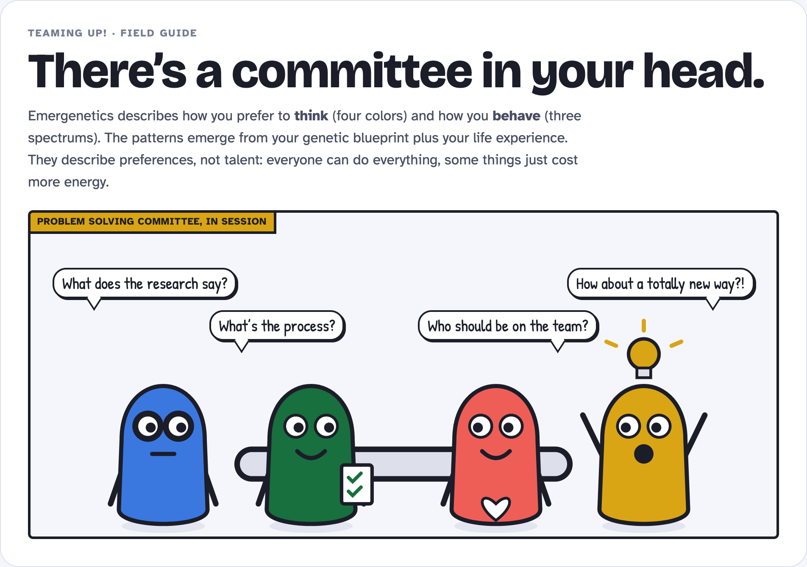
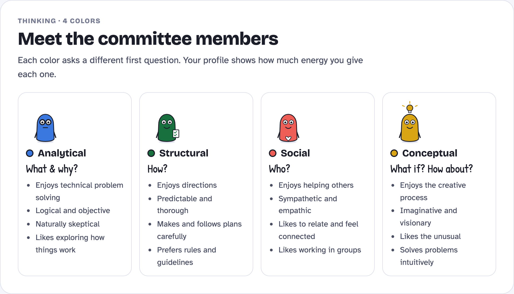
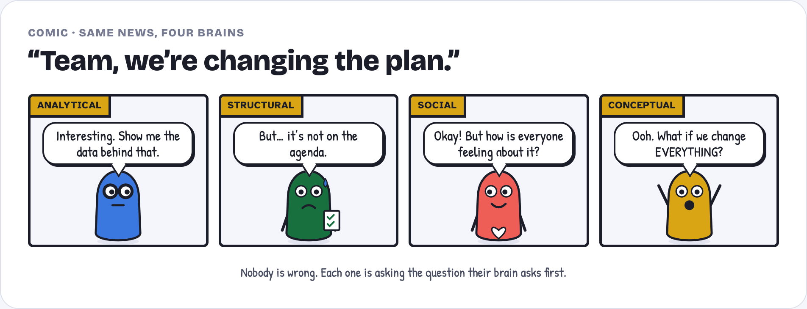
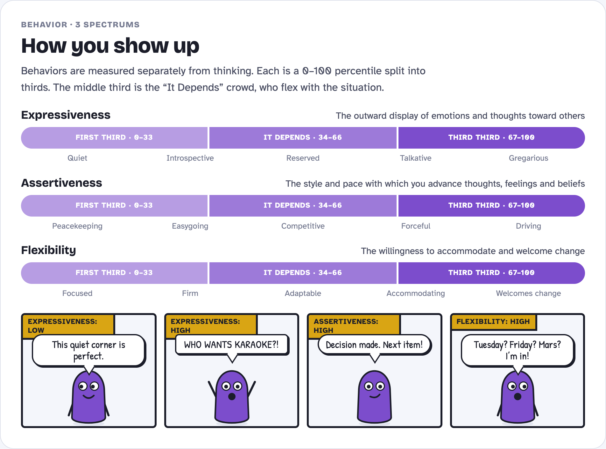
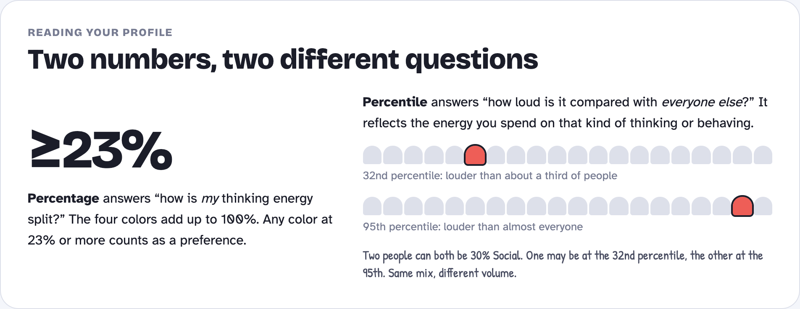
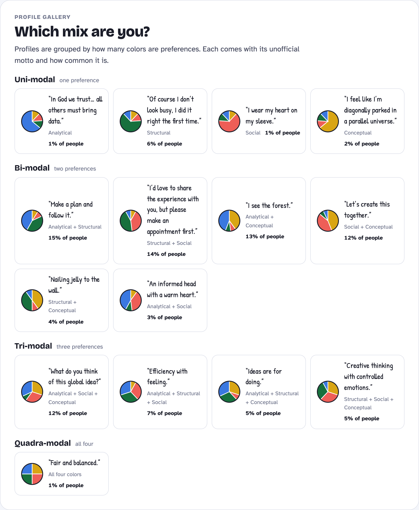
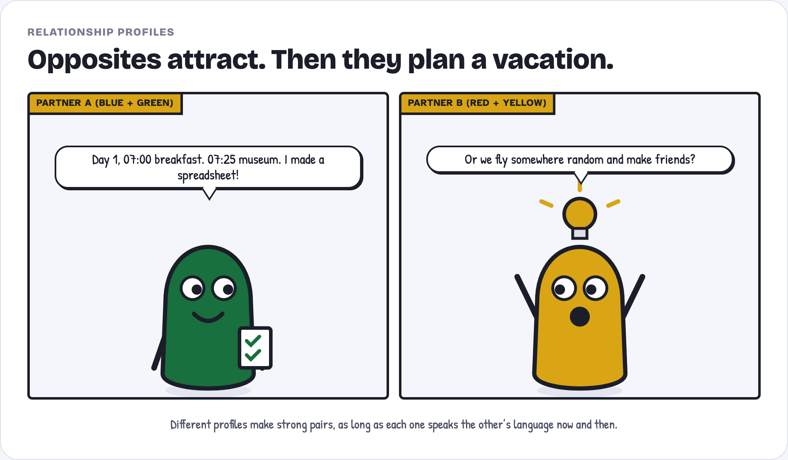
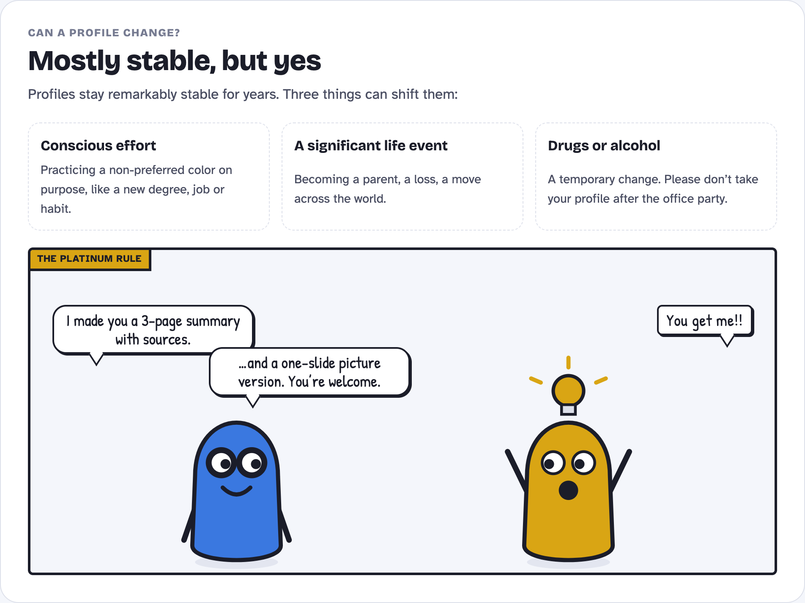

# telepath-tee

**Try it: https://work-kelv.github.io/telepath-tee/**

A small web app for finding out how your friends think. Each person answers 56 quick statements and immediately gets a visual profile of their **thinking preferences** and **behavioral style**, plus a shareable "How to work with me" card.

It is inspired by the Emergenetics® model of four thinking attributes and three behavioral attributes.

> **Unofficial.** This is not the Emergenetics Profile. The questionnaire items are original, and the scoring norms are provisional (see [Scoring](#scoring)). Use it as a conversation starter, not an assessment.



## Nothing is stored

The app asks for a name and nothing else, and it keeps nothing.

- **Scoring runs in your browser.** There is no server and no database. The site is plain static files.
- **Your report lives in its link.** The 56 answers and your name are packed into the part of the link after `#`, which is about 60 characters. Browsers never send that part to a website, so not even the host sees it.
- **Sharing is up to you.** Send the link to whoever you want to see your profile. If you lose it, take the questionnaire again; it takes about eight minutes.
- **The only thing saved is a draft.** Unfinished answers are kept in your own browser's storage so a closed tab doesn't lose them. The draft is deleted as soon as the report appears.

## Learn the model in five minutes

These graphics summarize the "Teaming Up! With Emergenetics" workshop. They are also available as one scrollable page: [docs/field-guide.html](docs/field-guide.html).

### Four ways of thinking

Everyone uses all four. Your profile shows how much energy you give each one, as a percentage that adds up to 100%. 23% or more counts as a preference.





### Three behaviors

Measured separately from thinking, each as a 0–100 percentile split into thirds. The middle third is the "It Depends" group, who flex with the situation.



### Reading a profile









## Features

- **Questionnaire.** 56 statements on a 1–7 agree scale, in 8 short steps. It shows progress, checks each step before moving on, and is built for phones first.
- **Personal report.** Shows the thinking-mix donut, percentile bars and behavior spectrums, plus a written summary, communication tips, ideal environment, interaction strategies and how others can flex toward you. **Save PDF** uses print-specific styles.
- **"How to work with me" card.** On phones, **Save as image** opens the share sheet (Save Image, Messages, WhatsApp and so on). On computers, it downloads a PNG.
- **Share link.** On phones this opens the share sheet; on computers it copies the link.
- **Group comparison.** Paste friends' report links into Compare to see everyone's thinking mix side by side, a combined-scores dot chart with the group average, missing thinking perspectives, pairs likely to clash (with tips) and pairs who think alike. The group lives in the compare page's own link. Anyone who receives it can also open each person's report.
- **Tested on phones.** Checked at 360px (Android) and 375px (iPhone SE) for sideways scrolling and tap-target size.

## Quick start

Requires Node 20 or newer.

```bash
npm install
npm run dev        # http://localhost:3000
```

| Command | What it does |
|---|---|
| `npm run dev` | Development server, also reachable from a phone on the same Wi-Fi |
| `npm run build` | Builds the static site into `out/` |
| `npm run preview` | Serves `out/` on port 4173 and prints a link for your phone |
| `npm test` | Unit tests for the scoring engine, report links and group analysis |
| `npm run typecheck` | TypeScript check |

> **On exFAT or other drives without symlinks**, install with `npm install --no-bin-links`. The npm scripts call `node node_modules/...` directly, so they work either way.

## Hosting

The site is hosted free on **GitHub Pages**. No other accounts or services are involved. Every push to `main` runs the tests, builds the site and publishes it, using `.github/workflows/ci.yml`.

To host your own copy, fork the repository. Then, under **Settings → Pages**, set **Source** to **GitHub Actions**. Your copy appears at `https://<your-username>.github.io/<repo-name>/`.

Because the result is plain static files, any static host works too, such as Netlify or Cloudflare Pages. Run `npm run build` and upload `out/`. Set `NEXT_PUBLIC_BASE_PATH` only when the site lives in a sub-folder, as it does on GitHub Pages.

## Pages

| Route | Purpose |
|---|---|
| `/` | Introduction to the seven attributes |
| `/assessment/` | The questionnaire |
| `/report/#<code>` | Personal report |
| `/card/#<code>` | "How to work with me" card |
| `/compare/#<code>~<code>~…` | Group comparison of up to 12 people |

A code looks like `1.<56 digits>.<name>`: a format version, one digit per answer, and the name in URL-safe Base64. See `src/lib/share.ts`.

## Scoring

1. **Raw score.** The mean of the 8 answers for each attribute, on the 1–7 scale. Two of the eight items are reverse-worded (`8 − answer`).
2. **Percentile.** `z = (raw − mean) / sd`, then the normal CDF, clamped to 1–99. This compares you with other people.
3. **Thinking percentage.** Each thinking percentile ÷ the sum of all four, rounded to total 100. This is your own mix. It reproduces the published sample profile exactly: percentiles 95/90/48/5 give 40/38/20/2%. That case is a unit test.
4. **Preference.** A thinking attribute at **≥ 23%**. The number of preferences gives uni-, bi-, tri- or quadra-modal.
5. **Behavior thirds.** 0–33, 34–66 ("It Depends") and 67–100, each with a five-step label such as Quiet → Gregarious.

**Norms are provisional.** The official instrument is normed against a large global population. The means and standard deviations in `src/lib/scoring.ts` (`NORMS`) are reasonable defaults for this item bank. Once you have a few dozen responses, consider replacing them with your group's own values.

### Comparing with an older profile

If someone has an older profile that exists only as published percentiles, `npm run reconstruct` estimates how they would have answered *these* 56 statements:

```bash
npm run reconstruct -- "<current report link>" old-profile.json out-dir --base-url=https://work-kelv.github.io/telepath-tee
```

It reverses the scoring, then moves the current answers by the fewest one-point steps needed to reproduce the old percentiles. It writes a JSON file and a CSV of then-vs-now answers, and prints a report link for the reconstructed profile plus a then-vs-now compare link. The estimate is the closest set of answers to today's that fits the old profile, not a record of real answers. See `scripts/old-profile.example.json` for the input format.

## Project layout

```
src/
  lib/
    attributes.ts   # the 7 attributes: definitions, colors, traits, tips
    questions.ts    # 56-item bank and step layout
    scoring.ts      # scoring engine (+ scoring.test.ts)
    insights.ts     # report narrative, interaction strategies, cheat sheet
    share.ts        # packs a profile into a link and back (+ share.test.ts)
    team.ts         # group averages, coverage, clashes, allies (+ team.test.ts)
  app/              # Next.js App Router pages, exported as static files
  components/       # charts, form, report, card, dot chart
scripts/            # preview server and reconstruct tool
docs/               # field guide and training graphics
```

**Stack.** Next.js 14 (App Router, static export) with TypeScript, Tailwind CSS, Recharts and lucide-react.

**Colors.** The thinking colors follow the Emergenetics convention (Analytical blue, Structural green, Social red, Conceptual yellow), with shades checked for color-vision deficiency. Every chart labels the attributes by name too, because red and green stay close for some readers.

## Credits

The model and terminology come from Emergenetics® (Browning & Williams). Emergenetics® is a registered trademark of Emergenetics International, which has no affiliation with this project. The graphics are original illustrations. Profile mottos and population shares are as presented in the "Teaming Up! With Emergenetics" workshop.

## License

[MIT](LICENSE) © 2026 Kelvin Tan. The license covers this project's code and original illustrations. It does not grant any rights to the Emergenetics® name or trademark.
